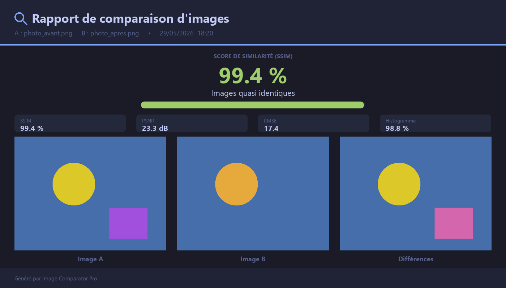

# 🔍 Image Comparator Pro

> Application de bureau pour **comparer deux images** : différences visuelles, score de
> similarité, analyse pixel par pixel et export d'un rapport — le tout dans une interface
> sombre moderne.




---

## ✨ Fonctionnalités

| Module | Description |
|--------|-------------|
| 🖼️ **Côte à côte / Avant-après** | Curseur « slider » pour révéler une image par-dessus l'autre, zoom à la molette **synchronisé** et déplacement (pan). |
| 🔬 **Différences visuelles** | 4 modes : surbrillance des zones modifiées, rectangles de détection, masque binaire, **carte de chaleur**. Curseur de sensibilité en temps réel. |
| 📊 **Score de similarité** | **SSIM**, **PSNR**, **RMSE** et corrélation d'**histogrammes**, avec un score global, une jauge colorée et une carte de similarité structurelle. |
| 🔢 **Analyse pixel par pixel** | Loupe au survol, valeurs **RGB** de A et B au même point, statistiques d'écart par canal, **histogrammes** superposés. |
| 🧭 **Correspondance (robuste à la rotation)** | Détection de points **ORB**, mise en correspondance, estimation de la **rotation/échelle**. Reconnaît une **même image pivotée**, affiche les lignes d'appariement et **réaligne** B sur A en recalculant le SSIM. |
| 💾 **Export** | Génère un **rapport PNG** complet (images + métriques + différences) en un clic. |

**Confort d'usage** : chargement par bouton, par clic ou par **glisser-déposer**, gestion
automatique des images de tailles différentes, chemins avec accents pris en charge,
rendu net sur écrans haute résolution.

---

## 🚀 Installation

Prérequis : **Python 3.10 ou supérieur** (Windows).

```bash
# 1. Récupérer le projet, puis dans le dossier :
pip install -r requirements.txt
```

Dépendances : `opencv-python`, `Pillow`, `numpy`, `scikit-image`, `tkinterdnd2`.

---

## ▶️ Utilisation

```bash
python app.py
```

Ou double-cliquez sur **`lancer.bat`**.

1. Chargez l'**image A** et l'**image B** (boutons, clic sur les zones, ou glisser-déposer).
2. Cliquez sur un mode d'analyse : *Côte à côte*, *Différences*, *Similarité* ou *Pixels*.
3. Cliquez sur **Exporter** pour enregistrer un rapport PNG.

### ⌨️ Raccourcis clavier

| Raccourci | Action |
|-----------|--------|
| `Ctrl + O` | Charger l'image A |
| `Ctrl + Maj + O` | Charger l'image B |
| `1` `2` `3` `4` `5` | Côte à côte · Différences · Similarité · Pixels · Correspondance |
| `Ctrl + E` | Exporter le rapport |
| `Ctrl + R` | Réinitialiser |
| `Échap` | Fermer une fenêtre d'analyse |

Dans les fenêtres d'analyse : **molette** = zoom, **clic droit** = déplacer,
**double-clic** = réinitialiser la vue.

---

## 📏 Comprendre les métriques

- **SSIM** *(0–100 %)* — similarité **structurelle**, proche de la perception humaine.
  C'est le score global affiché. *(Sur des images très simples/plates, il peut rester
  élevé même si les couleurs diffèrent : les autres métriques le complètent.)*
- **PSNR** *(dB)* — qualité ; plus la valeur est haute, plus les images sont proches
  (∞ si identiques).
- **RMSE** *(0–255)* — écart de couleur moyen ; plus bas = plus proche.
- **Histogramme** *(0–100 %)* — corrélation des distributions de couleurs.

> 💡 **Image identique mais pivotée ?** Le SSIM/RMSE compare les pixels *à la même
> position* : une image tournée donne donc un score bas, même si c'est le même contenu.
> Pour ce cas, utilisez le mode **🧭 Correspondance**, qui reconnaît le contenu malgré la
> rotation et réaligne automatiquement les images.

---

## 🗂️ Structure du projet

```
comparaison deux images/
├── app.py                # Fenêtre principale (chargement, aperçu, raccourcis, DnD)
├── theme.py              # Couleurs, polices, composants et helpers partagés
├── widgets.py            # Canvas réutilisable avec zoom / pan
├── compare_view.py       # Comparaison avant-après et côte à côte
├── diff_view.py          # Différences visuelles (4 modes + seuil)
├── similarity_view.py    # Score de similarité (SSIM, PSNR, RMSE, histogramme)
├── pixels_view.py        # Analyse pixel par pixel (loupe, stats, histogrammes)
├── matching_view.py      # Correspondance ORB robuste à la rotation + réalignement
├── export.py             # Génération et export du rapport PNG
├── lancer.bat            # Lancement en double-clic (Windows)
├── requirements.txt
└── docs/
    └── exemple_rapport.png
```

---

## 🛠️ Stack technique

**Python** · **Tkinter** (interface) · **OpenCV** & **NumPy** (traitement d'images) ·
**scikit-image** (SSIM) · **Pillow** (rendu & export) · **tkinterdnd2** (glisser-déposer).

---

*Réalisé avec ❤️ — Image Comparator Pro.*
